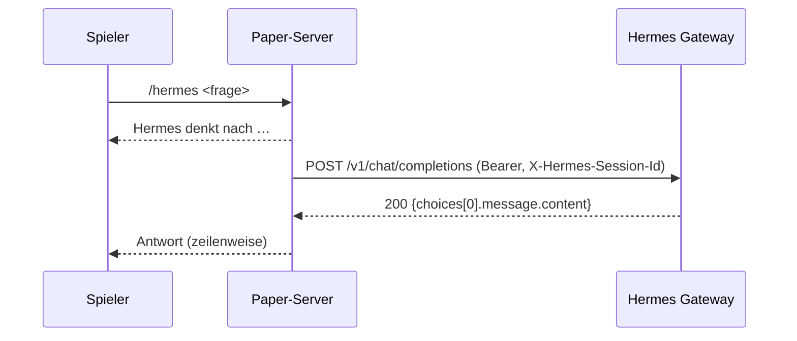

# HermesChat – Minecraft-Plugin für den Hermes-Agent (Design)

Datum: 2026-10-25 · Status: freigegeben (Design), Implementierung nach Spec-Review

## Ziel

Im Minecraft-Chat (Paper-Server 26.3) eine Frage an den eigenen Hermes-Agenten stellen und
dessen Antwort im Spiel erhalten – ohne das Spiel zu verlassen.

**Erfolgskriterium:** Ein Spieler mit `hermes.chat` tippt `/hermes <frage>`, sieht eine
Eingangsbestätigung und erhält die Antwort des Agenten als Chat-Nachricht. Folgefragen im
selben Spieler-Kontext haben die vorherige Konversation (serverseitig bei Hermes).

## Nicht-Ziele

- Kein Client-Mod, keine GUI, keine Sprachausgabe.
- Kein Streaming/Tool-Progress im Chat (kein SSE-Parsing).
- Keine mehrstufigen Approvals (`approval`/`clarify`) aus dem Spiel.
- Kein Multi-Server/Proxy-Support.

## Architektur

Ein Paper-Plugin, vier Klassen, keine externen Dependencies (Gson + Adventure kommen von Paper).

| Baustein | Aufgabe |
|---|---|
| `HermesChatPlugin` | `onEnable`: Config laden, Command registrieren, HTTP-Client bauen, Plugin deaktivieren bei fehlender Konfiguration |
| `HermesClient` | `POST {base-url}/v1/chat/completions` via `java.net.http.HttpClient.sendAsync`, JSON mit Gson, Antwort zurück auf den Main-Thread via Bukkit-Scheduler |
| `HermesCommand` | `/hermes <frage>`, `/hermes reset`; Permission- und Busy-Prüfung; Antwort-Formatierung/-Versand |
| `SessionKeys` | pro Spieler-UUID ein persistierter Session-Key (`data.yml`), damit Hermes die Konversation hält |

### Datenfluss

1. Spieler führt `/hermes <frage>` aus (Main-Thread).
2. Plugin prüft Permission, leere Eingabe, laufende Anfrage (Busy-Guard pro Spieler).
3. `HermesClient` sendet asynchron:
   - `Authorization: Bearer <api-key>`
   - `X-Hermes-Session-Id: mc-<uuid>` (Konversationskontinuität bei Hermes)
   - Body: `{"model":"<model>","messages":[{"role":"user","content":"<frage>"}],"stream":false}`
4. Antwort wird per `Bukkit.getScheduler().runTask` zurück auf den Main-Thread gereicht.
5. Antworttext wird an Zeilenumbrüchen geteilt (max. `max-chars` gesamt) und dem Fragenden
   gesendet; bei `broadcast: true` an alle Spieler.

## API-Vertrag

- Endpunkt: `POST {base-url}/v1/chat/completions` (Hermes API-Server, Default `http://127.0.0.1:8642/v1`).
- Auth: `Authorization: Bearer <api-key>` (Hermes `API_SERVER_KEY`).
- Erfolg: HTTP 200, `choices[0].message.content` nicht leer.
- Fehler: Nicht-200 → Klartextmeldung an den Spieler (HTTP-Code), Details ins Server-Log;
  `HttpTimeoutException` → „Hermes hat nicht rechtzeitig geantwortet“;
  `ConnectException`/`IOException` → „Hermes-Gateway nicht erreichbar“.
- Sehr lange Antworten werden bei `max-chars` abgeschnitten (Hinweis `… [gekürzt]`).

## Konfiguration (`config.yml`)

| Key | Default | Bedeutung |
|---|---|---|
| `base-url` | `http://127.0.0.1:8642/v1` | Hermes API-Server inkl. `/v1` |
| `api-key` | `change-me-local-dev` | Bearer-Token; bei Änderung Plugin neu laden |
| `model` | `hermes-agent` | wird von Hermes ohne `provider` ignoriert, wenn `direct_model_requests` aus ist – dann greift der Gateway-Default |
| `timeout-seconds` | `300` | Timeout pro Anfrage |
| `max-chars` | `1500` | maximale Antwortlänge im Chat |
| `broadcast` | `false` | Antwort an alle statt nur an den Fragenden |
| `session-prefix` | `mc-` | Präfix der `X-Hermes-Session-Id` |

## Verhalten

- `/hermes <frage>` – Frage senden. Alias `/h`. Ausführbar von Spielern und Konsole.
- `/hermes reset` – neuen Session-Key erzeugen (frische Konversation bei Hermes).
- Busy-Guard: pro Spieler max. eine laufende Anfrage; weitere Eingaben werden abgelehnt.
- Permission `hermes.chat` (default `op`) für die Nutzung; `hermes.reset` (default `op`).
- Fehlende/leere `base-url` oder `api-key` → Plugin deaktiviert sich mit Log-Fehler (kein stiller Fehlbetrieb).

## Build & Deployment

- Maven, `paper-api:26.3.build.222-stable` (`provided`), `maven.compiler.release=25`.
- Ergebnis: `target/hermes-chat-1.0.0.jar` → `plugins/` des Paper-26.3-Servers.
- `plugin.yml`: `api-version: '26.3'`, `main: de.navok.hermeschat.HermesChatPlugin`.
- Kein Shading nötig.

## Verifikation

1. Build erzeugt Jar ohne Fehler.
2. Paper-26.3-Server lokal starten, Jar einlegen, Plugin aktiv ohne Logfehler.
3. Python-Stub auf `:8642` beantwortet `/v1/chat/completions` und protokolliert Header/Body.
4. `/hermes Hallo` aus der Serverkonsole: Stub erhält Bearer + `X-Hermes-Session-Id: mc-console`,
   Antwort erscheint in der Konsole.
5. Fehlerfall: Stub aus → Spieler/Konsole erhält „nicht erreichbar“ statt Exception.

## Risiken

- `X-Hermes-Session-Id` bindet an eine API-Server-Session; existiert sie nicht, legt Hermes sie an.
  Ein Key, der einer Session einer anderen Oberfläche gehört, wird mit 409 abgelehnt → Fehlermeldung
  an den Spieler, `reset` hilft.
- Sehr lange Agent-Turns (> `timeout-seconds`) brechen ab; Erhöhen des Timeouts ist die Antwort,
  nicht Streaming (bewusste Scope-Entscheidung).
